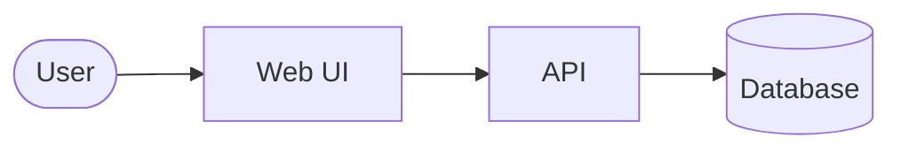
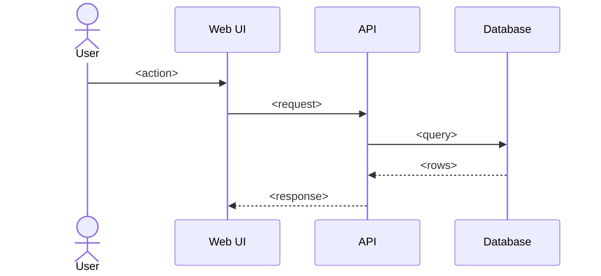

# NNNN. <Decision as a short statement, e.g. "Server-rendered pages with a thin JSON API">

- **Status:** Accepted <!-- or: Superseded by NNNN -->
- **Date:** YYYY-MM-DD
- **Feature:** <feature name / branch>
- **Sources:** <spec path(s), key commits>

## Context

<The problem and the forces: what mattered, what constrained us. Define new concepts in one plain sentence.>

## Decision

<What we chose, in one or two sentences.>

## How it works

*What to notice: <one sentence>.*

*What to notice: <one sentence>.*

## Alternatives considered

| Option | Optimises for | Costs | Why not here |
|---|---|---|---|
| **Chosen:** <X> | | | — |
| <Y> | | | |
| <Simplest thing / do nothing> | | | |

<Optional: a side-by-side flowchart of chosen vs best alternative.>

## Trade-offs

**What we gain**
- <Concrete benefit, with source.>

**What we give up**
- <Concrete cost or failure mode, with source.>

> **_Inferred:_** <Any reason not stated in a source, and what it was inferred from.>

## When to revisit

- <Observable signal that the trade-off has flipped.>

## Learn more

- <Pattern / book / canonical article name.>
