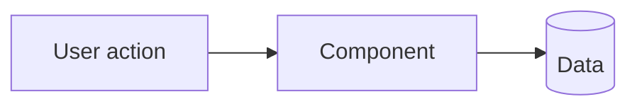
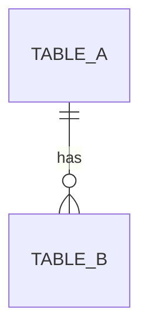

## What & why

<!-- 2–4 sentences: what changes for the user or the system, and why. Link the spec in docs/superpowers/specs/. -->

## See it

<!-- Show, don't tell. Delete the sections that don't apply, but every PR should keep at least one visual. -->

### UI (before → after)

<!-- Screenshots from docs/user-guide/media/<feature>/ (produced by feature-wrapup).
     PR descriptions need absolute URLs:
      -->

| Before | After |
|---|---|
| | |

▶ [Watch the video](<link to .webm on the branch>)

### Flow

### Database changes

<!-- Changed entities only. Mark new fields with a comment. Link the migration file. -->

Migration: `<path>` · Reversible: yes/no · Backfill needed: yes/no

### Architecture

<!-- Link the lesson from docs/architecture/ if feature-wrapup wrote one, and paste its main diagram. -->

## Security review

<!-- Result of /security-review. List any finding not fixed, with a one-line reason. -->

## How to test

1.
