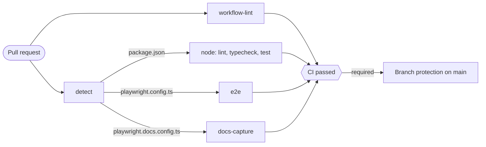

# 0001. Stack-agnostic CI behind one required check

- **Status:** Accepted
- **Date:** 2026-11-23
- **Feature:** CI and branch protection (`claude/project-thread-aym68o`)
- **Sources:** `.github/workflows/ci.yml`, `.github/dependabot.yml`, `docs/superpowers/specs/2026-11-23-ci-branch-protection-design.md`

## Context

We want every pull request checked (lint, typecheck, unit tests, Playwright E2E and doc captures) and `main` protected so nothing merges red. But no stack is chosen yet: there is no `package.json`, no test runner, no app to boot. Branch protection names its required checks *by job name*, so whatever we require today has to keep existing and keep meaning something after the stack lands.

A *required status check* is a check GitHub must see as successful on the PR's latest commit before the merge button unlocks.

## Decision

One workflow whose jobs switch on when the files they need appear, and one aggregate job, **`CI passed`**, which is the only check branch protection requires.

## How it works

*What to notice: branch protection only knows about `CI passed`; everything left of it can change without touching repo settings.*

`CI passed` runs with `if: always()` and fails when any job it depends on *failed or was cancelled*. A *skipped* job (its stack file doesn't exist yet) counts as passing.

## Alternatives considered

| Option | Optimises for | Costs | Why not here |
|---|---|---|---|
| **Chosen:** conditional jobs + one aggregate gate | Settings never change as CI grows | A small "gate" job; a skipped job is silently green | — |
| Require each job by name | Fine-grained, visible in the merge box | Every new/renamed job means editing branch protection; a required job that is *skipped* or never runs blocks merges forever | Brittle while the stack is moving |
| Write CI only after choosing a stack | No speculative YAML | `main` unprotected until then; first feature lands unchecked | We want the guardrail before the first line of app code |
| `paths:` filters on the workflow | Fewer runs | A filtered-out workflow reports *nothing*, which a required check reads as "pending forever" | Known GitHub footgun with required checks |

## Trade-offs

**What we gain**
- Green today, grows automatically: adding `package.json` with `lint`/`typecheck`/`test` scripts turns those checks on with no CI edit (`npm run <x> --if-present`).
- Branch protection is configured once.
- Supply-chain hygiene: read-only `GITHUB_TOKEN`, no secrets, `persist-credentials: false`, actions pinned to commit SHAs and bumped by Dependabot.

**What we give up**
- *Silent green.* If someone deletes the `lint` script, lint quietly stops running and CI stays green. Mitigation: once the stack exists, drop `--if-present` so missing scripts fail.
- Assumes npm and Node 22 (or `.nvmrc`). A pnpm/Bun/Python stack means editing the `node` job; the gate and the settings stay.
- Doc captures on every PR are slow (videos, `slowMo`). Fine at our size; revisit if PR feedback gets slow.

## When to revisit

- The stack is chosen: remove `--if-present`, add the npm Dependabot entry, decide whether doc captures run on every PR or only when UI files change.
- CI wall time passes ~10 minutes, or we need merge queues (add `merge_group:` to the triggers).

## Learn more

- "Required status checks" and "skipped jobs" in the GitHub Actions docs.
- OpenSSF Scorecard: *Pinned-Dependencies* and *Token-Permissions* checks.
