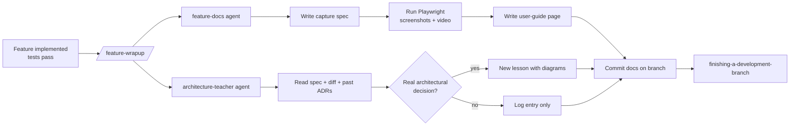

# Feature wrap-up agents: user docs + architecture lessons

Date: 2026-11-23 · Status: approved by Jacob (approaches A + A)

## Intent

When a feature in SimpleFactory (a web app) is finished, two things should exist before the branch is merged:

1. **User documentation** — a short, task-focused help page for the app's *end users*, with screenshots and a short video of the feature working.
2. **An architecture lesson** — for Jacob and future developers: why the architecture was chosen, its trade-offs, pros/cons and the alternatives, always illustrated with diagrams/flowcharts.

## Goals

- Docs are produced as a routine step at the end of every feature, alongside Superpowers' `finishing-a-development-branch`.
- Screenshots and video are **reproducible**: re-running one command refreshes all of them when the UI changes.
- Architecture lessons are **honest**: reasoning is traced to the design spec or code; anything inferred is labelled as such.

## Non-goals

- Publishing the docs site (VitePress / GitHub Pages) — later, reuses the same markdown.
- In-app help pages — later, reuses the same markdown.
- Picking SimpleFactory's stack. The agents are stack-agnostic.

## Anti-goals (failure even if it "works")

- User docs full of developer jargon, code, or test data like `asdf@test.com`.
- Screenshots that silently go stale.
- Architecture lessons that rationalise after the fact ("we chose X because it's scalable") with no real decision behind them.
- A noisy trigger that runs on every session stop.

## Approaches considered

| Decision | Option | Trade-off | Chosen |
|---|---|---|---|
| Trigger | Hook (Stop / SubagentStop) | Automatic, but hooks can't know a *feature* is done → noise or misses | ✗ |
| | Skill `/feature-wrapup` + CLAUDE.md rule | Explicit and reliable; relies on the workflow being followed | ✓ |
| Capture | **A. Scripted Playwright spec per feature** | Re-runnable, doubles as smoke test; needs seedable demo state | ✓ |
| | B. Ad-hoc browser clicks | Fast; goes stale silently | ✗ |
| Where users read | **A. Markdown in repo → static site later** | Versioned + reviewed with code; separate site from app | ✓ |
| | B. In-app help | Best UX; couples docs to a frontend that doesn't exist yet | later |
| Diagrams | Mermaid in markdown | Text-diffable, GitHub renders natively; limited layout control | ✓ |
| | Images (Excalidraw/draw.io) | Prettier; binary, can't be reviewed in a diff | ✗ |

## Design

```
.claude/
  agents/
    feature-docs.md            # end-user docs + Playwright capture
    architecture-teacher.md    # ADR-style lessons with Mermaid
  skills/feature-wrapup/
    SKILL.md                   # orchestrates both agents in parallel
    templates/                 # Playwright config + capture spec example
CLAUDE.md                      # rule: run /feature-wrapup before finishing a branch
docs/
  user-guide/<feature>.md      # end-user pages
  user-guide/media/<feature>/  # screenshots (.png) + video (.webm)
  capture/<feature>.spec.ts    # reproducible capture scripts
  architecture/NNNN-<slug>.md  # lessons (ADR-style)
```

Flow:



Key rules:

- **Demo state requirement.** Captures run against the app booted with deterministic seed data and a demo login. Until the app provides that, the feature-docs agent reports the gap instead of faking it.
- **Video budget.** Videos are ≤ 30 s and ≤ 5 MB each; screenshots are PNG at 1280×800. If media grows past ~50 MB total, move to Git LFS.
- **GitHub caveat.** github.com does not inline-play `.webm` from the repo; pages show a poster screenshot linking to the video. The future docs site will play it inline via `<video>`.
- **Honesty rule.** Every "why" in a lesson cites its source (spec section, commit, or code). Unsourced reasoning is marked *Inferred*. If the feature contains no architectural decision, the agent writes no lesson and adds a one-line entry to `docs/architecture/README.md` instead.

## Left to the builder

Exact prompt wording, templates, and the Playwright config defaults.
